# Projet Microservices - E-Bank

Ce projet est réalisé dans le cadre du module Architecture Microservices.
L'objectif est de créer une petite application bancaire basée sur des microservices avec Spring Boot et Spring Cloud.

## Description

L'application contient deux services métier :
- **Customer-Service** : gestion des clients
- **EBank-Service** : gestion des comptes bancaires

Le service EBank récupère les informations du client en appelant Customer-Service avec OpenFeign.

On a aussi :
- un **Discovery Service** (Eureka) pour enregistrer les services
- une **Gateway** pour accéder aux services depuis un seul point d'entrée

## Travail demandé

1. Développer le service Customer-Service
2. Développer le service EBank-Service
3. Communication entre les deux services avec OpenFeign
4. Fault Tolerance avec Circuit Breaker (Resilience4J)
5. Développer la Gateway
6. Développer le Discovery Service
7. Tester les services avec Postman et Swagger-UI

## Technologies utilisées

- Java 17
- Spring Boot 4
- Spring Data JPA, H2
- Spring Cloud (Eureka, Gateway, OpenFeign)
- Resilience4J
- Lombok
- Swagger (SpringDoc)
- IntelliJ IDEA, Maven

## Ports

- discovery-service : 8761
- gateway-service : 8888
- customer-service : 8081
- ebank-service : 8082

Ordre de lancement : discovery-service, customer-service, ebank-service, puis gateway-service.

## Réalisation

### 1. Customer-Service

Service qui gère les clients avec une base H2. Au démarrage, 3 clients sont ajoutés.

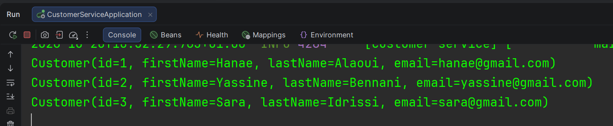
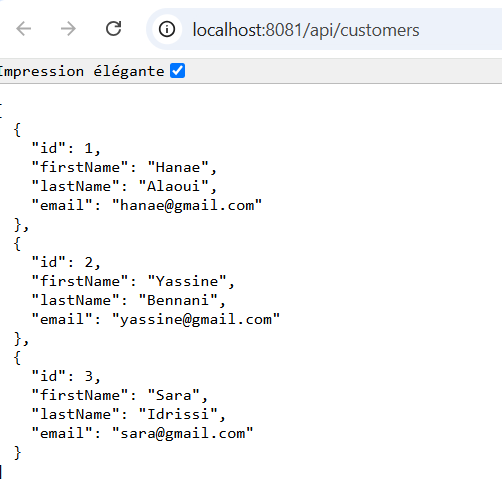
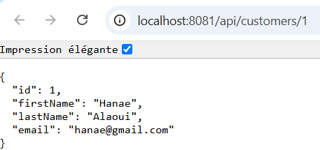

### 2. EBank-Service

Service qui gère les comptes bancaires. Chaque client a un compte courant et un compte épargne.
Le compte garde seulement l'id du client (`customerId`), le client reste dans customer-service.

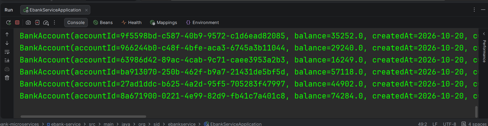
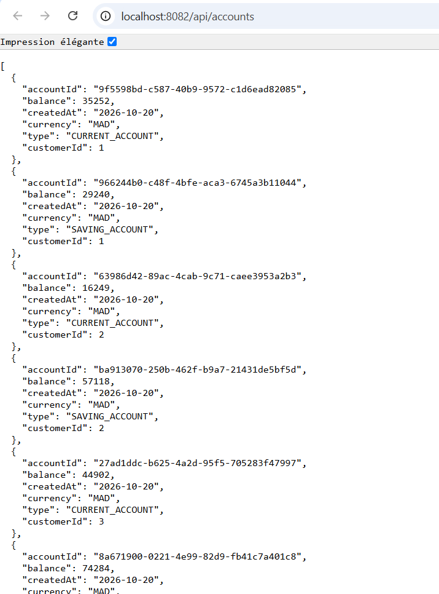
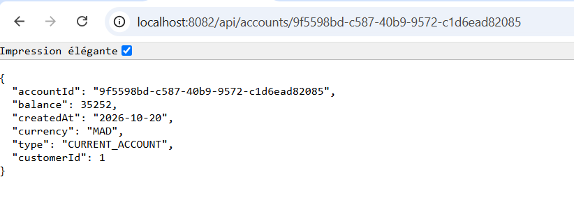

### 3. Communication avec OpenFeign

ebank-service appelle customer-service avec l'interface `CustomerRestClient` pour remplir le client de chaque compte.

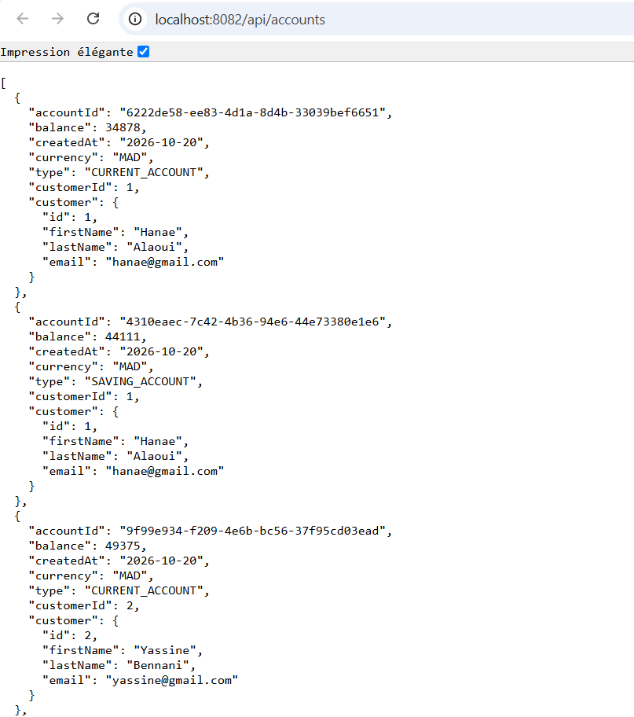
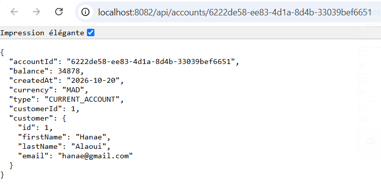

### 4. Circuit Breaker avec Resilience4J

Quand customer-service est arrêté, la requête plantait (erreur 500).

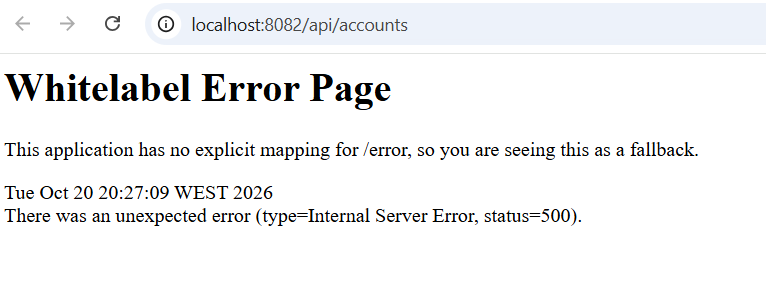

Avec le Circuit Breaker, la classe `CustomerRestClientFallback` renvoie un client par défaut, et les comptes s'affichent quand même.

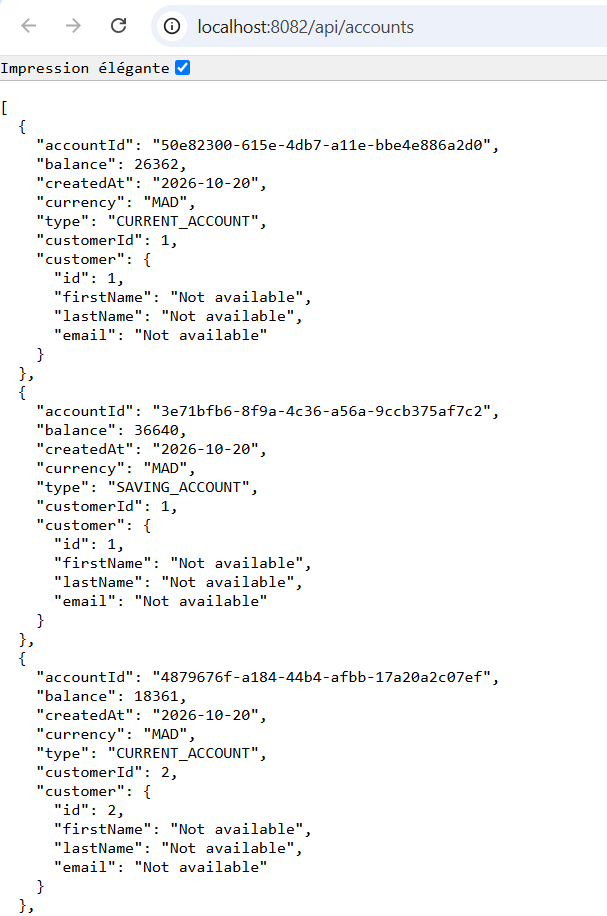
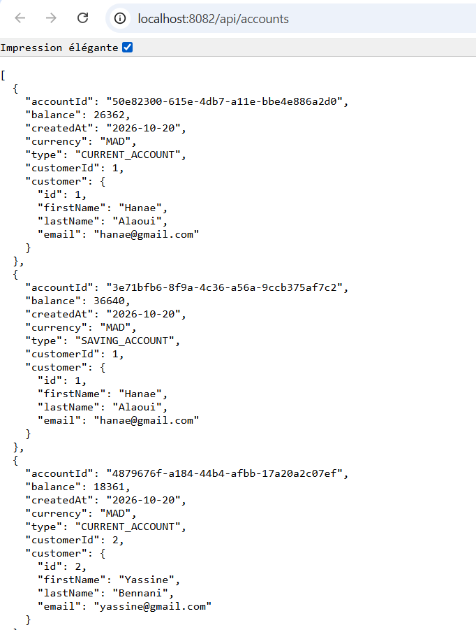

### 5. Discovery Service

Serveur Eureka sur le port 8761. customer-service, ebank-service et gateway-service s'y enregistrent.
Feign n'a plus besoin de l'URL de customer-service, il le trouve par son nom.

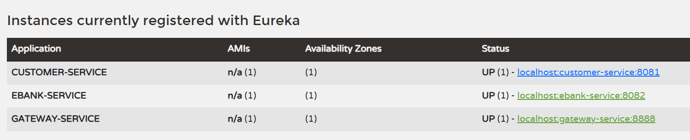

### 6. Gateway

Point d'entrée unique sur le port 8888. Les routes utilisent `lb://` pour trouver les services dans Eureka.

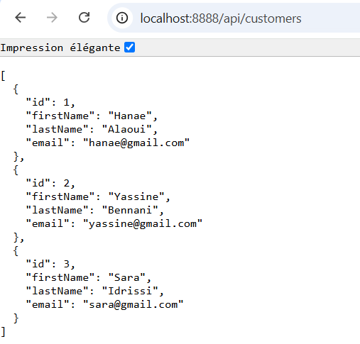
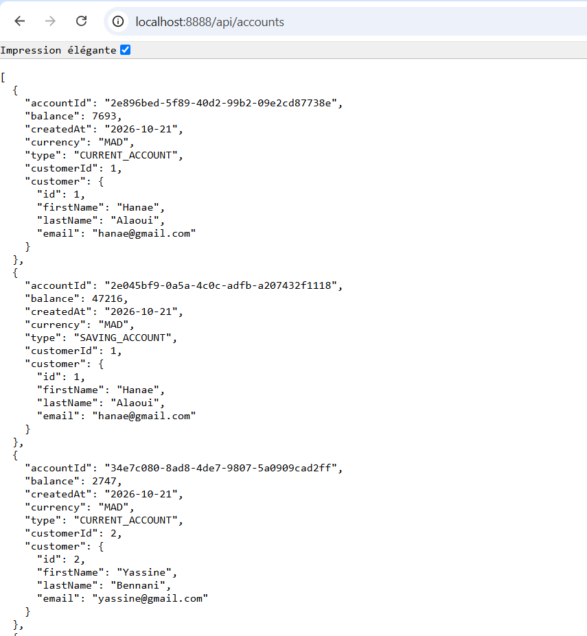

### 7. Tests avec Swagger et Postman

Swagger UI : http://localhost:8081/swagger-ui.html et http://localhost:8082/swagger-ui.html

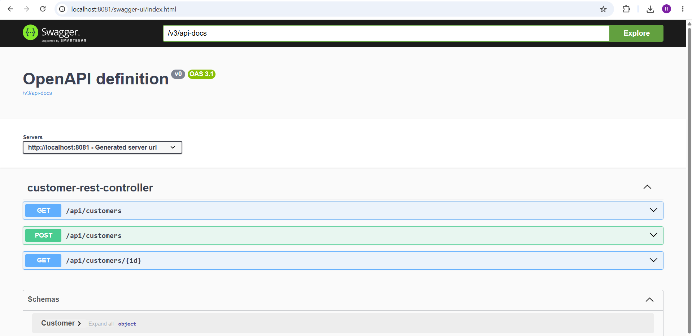
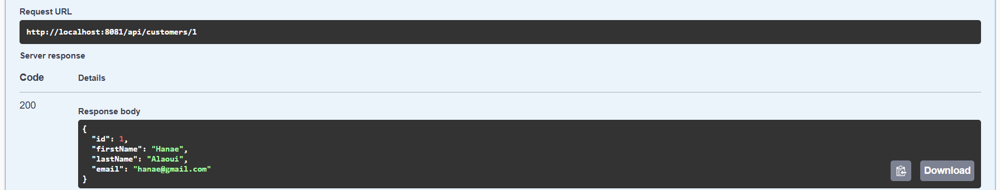
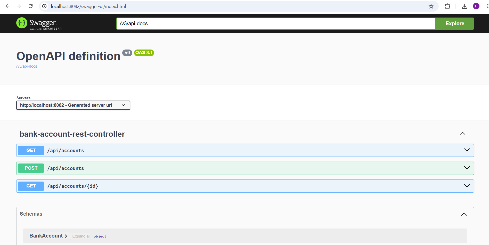
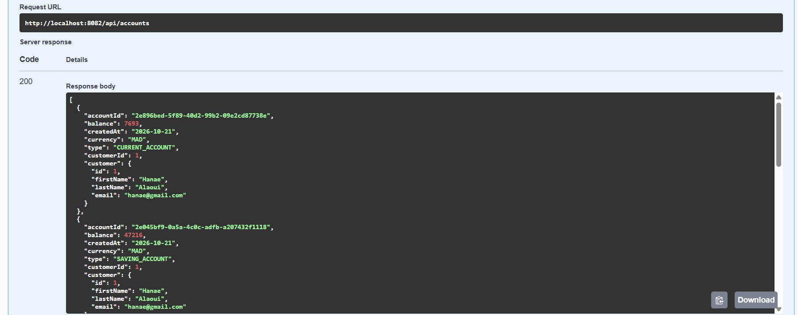

La collection Postman est dans le dossier `postman/`.

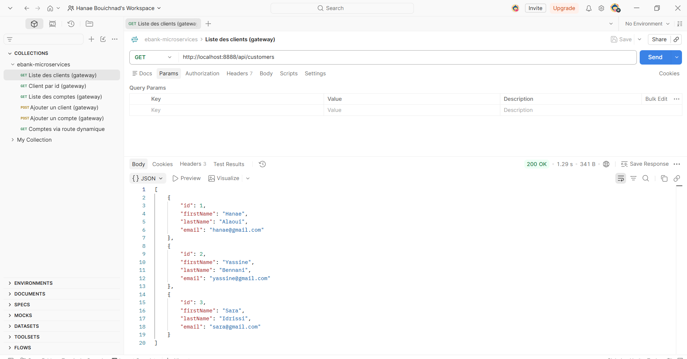
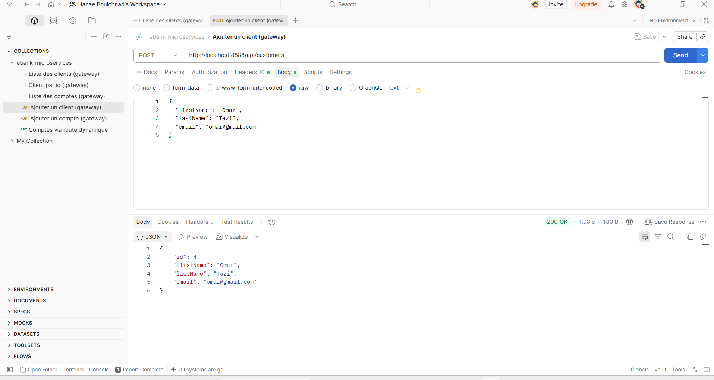

## Réalisé par

Hanae - EMSI
